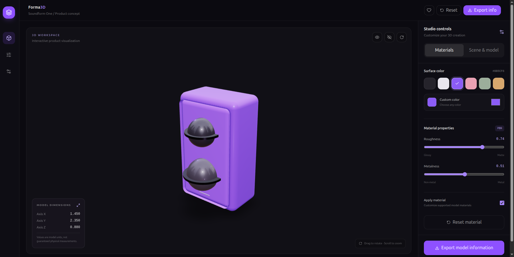

# Forma3D — Interactive 3D Product Studio

**Forma3D** is a browser-based 3D product visualization studio that lets users import 3D models, explore them interactively, customize their materials, and inspect their dimensions through a modern, immersive interface.

Built with React, TypeScript, and Three.js, Forma3D aims to make 3D product visualization more accessible through a clean, interactive workspace.

## ✨ Features

- **Interactive 3D Viewer** — Rotate, zoom, and explore 3D objects in real time.
- **3D Model Import** — Upload supported `.glb` and `.gltf` files.
- **Material Customization** — Adjust model colors, roughness, and metalness.
- **Model Dimensions** — Inspect the dimensions of imported 3D models.
- **Demo Model** — Explore the studio using a procedural 3D speaker model.
- **Model Information Export** — Download a JSON file containing model information.
- **Modern Interface** — Dark, purple-themed UI designed for a focused 3D workflow.
- **Responsive 3D Scene** — Interactive rendering powered by Three.js and React Three Fiber.

## 🛠️ Tech Stack

| Technology | Purpose |
|---|---|
| React | User interface |
| TypeScript | Type-safe development |
| Vite | Development server and build tooling |
| Three.js | 3D rendering |
| React Three Fiber | React renderer for Three.js |
| React Three Drei | 3D scene helpers and controls |
| Tailwind CSS | Styling |
| Lucide React | Interface icons |
| Motion | UI animations |

## 🚀 Getting Started

### Prerequisites

- Node.js
- npm
- Git

### Installation

1. Clone the repository:

   ```bash
   git clone https://github.com/Hayat373/forma3d.git
   ```

2. Navigate to the project directory:

   ```bash
   cd forma3d
   ```

3. Install dependencies:

   ```bash
   npm install
   ```

4. Start the development server:

   ```bash
   npm run dev
   ```

5. Open the local URL displayed in your terminal, usually `http://localhost:5173`.

## 🏗️ Production Build

Build the project for production:

```bash
npm run build
```

To preview the production build locally:

```bash
npm run preview
```

The generated production files are placed in the `dist` directory.

## 📖 How to Use

1. Open Forma3D in your browser.
2. Explore the default 3D speaker or import a supported 3D model.
3. Rotate and zoom the model using the 3D viewer controls.
4. Customize the model's color, roughness, and metalness.
5. Inspect the available model dimensions.
6. Export the available model information as a JSON file.

**Note:** The current export feature downloads model information in JSON format; it does not export a reconstructed `.glb` file.

## 🖼️ Screenshots

Add screenshots of the application to showcase the interface and 3D viewer.

Once you have a screenshot, save it as `forma3d-preview.png` inside the `public` directory and uncomment the following lines:

```markdown
<!-- Uncomment after adding public/forma3d-preview.png -->

<!--  -->
```

## 🌐 Live Demo

**Live application:** https://forma3d-q4fgcmvdt-hayats-projects-e4ba8944.vercel.app/.

**GitHub repository:** https://github.com/Hayat373/forma3d

## 🗺️ Roadmap

Potential future improvements include:

- Export customized 3D models as `.glb` files.
- Improve support for imported 3D assets and materials.
- Add more realistic product models and lighting environments.
- Add advanced material presets and lighting controls.
- Improve mobile and small-screen usability.

## 🤝 Contributing

Contributions, ideas, and feedback are welcome. Fork the repository, create a branch for your changes, and submit a pull request.


**Forma3D** — Explore. Customize. Visualize.